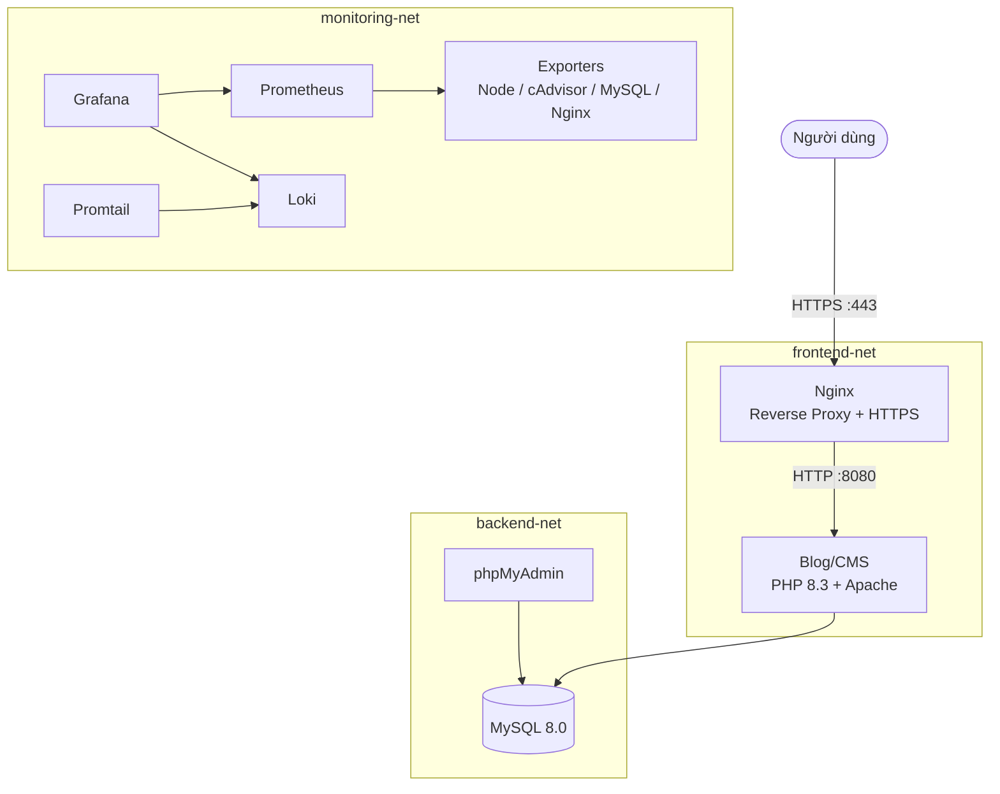

# 🚀 Đề 7 — Hệ thống Blog / CMS

<p align="center">
  <strong>Triển khai Blog/CMS bằng Docker Compose với HTTPS, Monitoring và Centralized Logging</strong>
</p>

<p align="center">
  
  
  
  
  
</p>

> Đồ án triển khai một hệ thống Blog/CMS theo mô hình thực tế, tích hợp reverse proxy, HTTPS, network isolation, monitoring bằng Prometheus/Grafana và centralized logging bằng Loki/Promtail.

## 📌 Thông tin đồ án

| Hạng mục | Nội dung |
| --- | --- |
| 👨‍🎓 Sinh viên | Lê Nam Khánh |
| 🆔 MSSV | `DTC245220024` |
| 🏫 Lớp | `ATTT_K23A` |
| 💻 Môi trường | Ubuntu 24.04 LTS trên VMware |
| 🐳 Nền tảng | Docker Engine và Docker Compose |

## 📚 Mục lục

- [Tổng quan](#-tổng-quan)
- [Kiến trúc](#️-kiến-trúc)
- [Các thành phần](#-các-thành-phần)
- [Yêu cầu](#-yêu-cầu)
- [Cài đặt và khởi chạy](#-cài-đặt-và-khởi-chạy)
- [Truy cập dịch vụ](#-truy-cập-dịch-vụ)
- [Monitoring và Logging](#-monitoring-và-logging)
- [Kiểm tra bảo mật](#-kiểm-tra-bảo-mật)
- [Dừng và dọn dẹp](#-dừng-và-dọn-dẹp)
- [Tác giả](#-tác-giả)

## 🎯 Tổng quan

Hệ thống cung cấp giao diện quản lý đơn giản cho:

- Bài viết và danh mục.
- Người dùng và vai trò.
- Cơ sở dữ liệu MySQL được cô lập trong mạng backend.
- Metrics hạ tầng, container, MySQL và Nginx.
- Thu thập log Docker tập trung để truy vấn trên Grafana/Loki.

## 🏗️ Kiến trúc



### Phân tách mạng

| Network | Mục đích |
| --- | --- |
| `frontend-net` | Kết nối Nginx với ứng dụng |
| `backend-net` | Kết nối ứng dụng, MySQL và phpMyAdmin |
| `monitoring-net` | Metrics và log của hệ thống |

MySQL không publish cổng `3306` ra máy host.

## 🧩 Các thành phần

| Thành phần | Vai trò | Cổng host |
| --- | --- | --- |
| Nginx | Reverse proxy, chuyển HTTP sang HTTPS, security headers | `80`, `443` |
| Blog/CMS | Ứng dụng PHP 8.3 + Apache | Qua Nginx |
| MySQL | Lưu trữ dữ liệu Blog/CMS | Nội bộ |
| phpMyAdmin | Quản trị MySQL qua giao diện web | `8082` |
| Prometheus | Thu thập metrics | `9090` |
| Grafana | Dashboard metrics và log | `3000` |
| cAdvisor | Metrics container | `8081` |
| Node Exporter | Metrics máy chủ | `9100` |
| MySQL Exporter | Metrics MySQL | `9104` |
| Nginx Exporter | Metrics Nginx | `9113` |
| Loki | Lưu trữ log | `3100` |
| Promtail | Thu thập log Docker | Nội bộ |

## ✅ Yêu cầu

- Docker Engine 24 trở lên.
- Docker Compose v2 (`docker compose`).
- OpenSSL.
- Linux, macOS hoặc Windows có Docker Desktop.

## 🚀 Cài đặt và khởi chạy

### 1. Clone repository

```bash
git clone https://github.com/Khanhslee/DTC245220024_De7-Blog-CMS.git
cd DTC245220024_De7-Blog-CMS
```

### 2. Tạo file môi trường

```bash
cp .env.example .env
```

Mở `.env` và thay toàn bộ giá trị `ChangeMe_...` bằng mật khẩu riêng trước khi chạy. File `.env` không được commit lên Git.

> `prometheus/.my.cnf` phải sử dụng đúng thông tin đăng nhập của `exporter_user` đã cấu hình trong `.env`/MySQL. Không đưa mật khẩu thật vào repository công khai.

### 3. Tạo chứng chỉ HTTPS tự ký

```bash
mkdir -p nginx/certs

openssl req -x509 -nodes -days 365 \
  -newkey rsa:2048 \
  -keyout nginx/certs/nginx.key \
  -out nginx/certs/nginx.crt \
  -subj "/C=VN/ST=ThaiNguyen/L=ThaiNguyen/O=ICTU/OU=ATTT/CN=localhost"
```

Trình duyệt sẽ hiển thị cảnh báo vì chứng chỉ dùng cho môi trường phát triển và là chứng chỉ tự ký.

### 4. Khởi động toàn bộ hệ thống

```bash
docker compose up -d --build
```

Kiểm tra trạng thái và log:

```bash
docker compose ps
docker compose logs -f --tail=100
```

## 🌐 Truy cập dịch vụ

| Dịch vụ | Địa chỉ |
| --- | --- |
| Blog/CMS | [https://localhost](https://localhost) |
| phpMyAdmin | [http://localhost:8082](http://localhost:8082) |
| Prometheus | [http://localhost:9090](http://localhost:9090) |
| Grafana | [http://localhost:3000](http://localhost:3000) |
| cAdvisor | [http://localhost:8081](http://localhost:8081) |

Thông tin đăng nhập được lấy từ file `.env`. Không sử dụng mật khẩu mặc định trong môi trường production.

### Datasource cho Grafana

Thêm hai datasource sau trong Grafana:

```text
Prometheus: http://prometheus:9090
Loki:       http://loki:3100
```

Có thể import các dashboard Grafana phổ biến:

| Dashboard | ID |
| --- | ---: |
| Node Exporter Full | `1860` |
| Docker Monitoring | `14282` |
| Nginx Monitoring | `12708` |
| MySQL Monitoring | `7362` |

## 📊 Monitoring và Logging

### Truy vấn log bằng LogQL

```logql
# Log của Blog/CMS và Nginx
{container=~"blog-app|nginx-proxy"}

# Theo dõi HTTP request
{container="blog-app"} |~ "GET|POST"

# Log MySQL
{container="mysql-db"}

# Lọc lỗi và cảnh báo
{service=~"blog-app|mysql|nginx"} |~ "(?i)error|warn"
```

## 🔐 Kiểm tra bảo mật

### Container không chạy bằng root

```bash
docker compose exec blog-app id
```

Ứng dụng được cấu hình chạy bằng user `www-data` (UID `33`).

### Kiểm tra HTTPS và security headers

```bash
curl -k -I https://localhost
```

Nginx được cấu hình với:

- TLS 1.2 và TLS 1.3.
- HTTP → HTTPS redirect.
- `X-Frame-Options`.
- `X-Content-Type-Options`.
- `X-XSS-Protection`.
- `Referrer-Policy`.
- `server_tokens off`.

### Kiểm tra network isolation

```bash
docker network ls
docker compose exec blog-app getent hosts mysql
```

MySQL chỉ nằm trong `backend-net` và không mở cổng trực tiếp ra host.

### Kiểm tra quyền database

```bash
docker compose exec mysql \
  mysql -u root -p -e \
  "SHOW GRANTS FOR 'wp_app_user'@'%';
   SHOW GRANTS FOR 'exporter_user'@'%';"
```

Khi chạy lệnh trên, nhập mật khẩu root từ `.env` tại prompt; không ghi mật khẩu trực tiếp vào shell history.

## 🧹 Dừng và dọn dẹp

```bash
# Dừng container nhưng giữ lại dữ liệu
docker compose down

# Xóa container và toàn bộ volume dữ liệu
docker compose down -v
```

> Chỉ dùng `docker compose down -v` khi chắc chắn muốn xóa dữ liệu MySQL, Prometheus, Grafana và Loki.

## 👨‍💻 Tác giả

**Lê Nam Khánh**  
MSSV: `DTC245220024` · Lớp: `ATTT_K23A`

[GitHub: @Khanhslee](https://github.com/Khanhslee)
